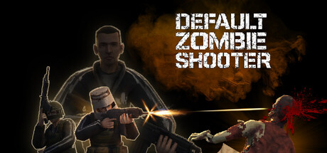

# Indie 3D Editor

[](https://store.steampowered.com/app/5570280/Default_Zombie_Shooter/?beta=0)

**[Add Default Zombie Shooter to your wishlist. Support the author.](https://store.steampowered.com/app/5570280/Default_Zombie_Shooter/?beta=0)**

**[Добавьте Default Zombie Shooter в желаемое. Поддержите автора.](https://store.steampowered.com/app/5570280/Default_Zombie_Shooter/?beta=0)**

You and your team woke up in a ruined city. Hordes of zombies roam the streets. There will be no answers. Grab a gun and shoot!

Вы с командой очнулись в разрушенном городе. По улицам бродят орды зомби. Ответов не будет. Берите оружие и стреляйте.

A mesh editor for Unity 6: Edit Mesh, Edit UV, Retopology, and Create Primitive. Only one of Edit Mesh, Edit UV, and Retopology can be active. Entering one closes the other and writes its result.

Редактор меша для Unity 6: Edit Mesh, Edit UV, Retopology и Create Primitive. Одновременно активен только один из режимов Edit Mesh, Edit UV и Retopology. Вход в один закрывает другой и записывает его результат.

In this text, Ctrl means the Ctrl key on Windows and the Command key on macOS. The code accepts both.

Ctrl в этом тексте — клавиша Ctrl в Windows и Command в macOS. Код принимает обе.

## Installation

## Установка

You need Unity `6000.4` or newer and Git installed.

Нужен Unity `6000.4` или новее и установленный Git.

1. Put the contents of this folder at the root of a separate repository. `package.json` must sit at the root, not in a nested folder.
2. In the target project, open the Package Manager, click `+`, and choose Add package from git URL.
3. Paste the repository address:

1. Выложите содержимое этой папки в корень отдельного репозитория. `package.json` должен лежать в корне, не во вложенной папке.
2. В целевом проекте откройте Package Manager, нажмите `+` и выберите Add package from git URL.
3. Вставьте адрес репозитория:

```text
https://github.com/USER/REPO.git
```

A specific version is installed with a tag:

Конкретная версия ставится тегом:

```text
https://github.com/USER/REPO.git#v1.0.0
```

The package shows up under `Packages` as Indie 3D Editor. It is not copied into `Assets`.

Пакет появляется в `Packages` под именем Indie 3D Editor. В `Assets` он не копируется.

Saved meshes are written into the user's project, at `Assets/Indie 3D Editor/Generated`. Unity creates that folder on the first save. It is not in the repository, and updating the package does not overwrite it.

Сохранённые меши пишутся в проект пользователя, в `Assets/Indie 3D Editor/Generated`. Эту папку Unity создаёт при первом сохранении. Её нет в репозитории, и обновление пакета её не затирает.

Components in the Add Component menu:

Компоненты в меню Add Component:

- Indie 3D Editor / Indie Edit Mesh Component
- Indie 3D Editor / Indie Edit UV Component
- Indie 3D Editor / Indie Retopology Component
- Indie 3D Editor / Indie Convert To Retopology
- Indie 3D Editor / Indie Create Primitive

A primitive is also created from `GameObject/Create Primitive`.

Примитив также создаётся пунктом `GameObject/Create Primitive`.

## How to read modifiers

## Как читать модификаторы

Every button below uses the same set of blocks. If a modifier does not affect the button, the text says so. Scene gestures (click, marquee, drag) are separate: they are not inspector buttons, and the modifiers change those gestures.

У каждой кнопки ниже один и тот же набор блоков. Если модификатор на кнопку не влияет, так и написано. Жесты сцены (клик, рамка, перетаскивание) разобраны отдельно: это не кнопки инспектора, и модификаторы меняют именно их.

The gear `⚙` next to an operation opens the settings window and a live preview. The button itself runs the operation with the current numbers. Accept applies the preview, Cancel rolls it back, and Close shuts the window when the session is already gone.

Шестерёнка `⚙` рядом с операцией открывает окно параметров и живой предпросмотр. Сама кнопка выполняет операцию с текущими числами. Accept в окне применяет предпросмотр, Cancel откатывает его, Close закрывает окно, если сессии уже нет.

# Edit Mesh

# Edit Mesh

The component goes on an object with a MeshFilter and a mesh. Edit enters the mode and hides Unity's standard tools. Its own undo stack works while the mode is open.

Компонент вешается на объект с MeshFilter и мешем. Кнопка Edit входит в режим и прячет стандартные инструменты Unity. Свой стек отмены работает, пока режим открыт.

The Vertex / Edge / Polygon switch changes what is picked and which buttons are visible. Cut turns off outside Vertex, and Point-to-Point Selection turns off outside Edge. The selection is kept when the mode changes.

Переключатель Vertex / Edge / Polygon меняет, что выбирается и какие кнопки видны. Cut выключается вне Vertex, Point-to-Point Selection выключается вне Edge. Выделение при смене режима сохраняется.

The Selection Transform window opens by itself when something is selected and closes when the selection is empty. For Move it shows an absolute position, for Rotate an absolute rotation. The X, Y, and Z fields set the value. The World / Local switch exists only for position.

Окно Selection Transform само открывается, когда что-то выделено, и закрывается, когда выделения нет. Для Move показывает абсолютную позицию, для Rotate — абсолютный поворот. Поля X, Y, Z задают значение. Переключатель World / Local есть только у позиции.

## Scene selection

## Выбор в сцене

Click and marquee work in the current mode: vertices, edges, or polygons.

Клик и рамка работают в текущем режиме: вершины, рёбра или полигоны.

No modifier. A short click on an element replaces the selection with that element. A click on empty space clears the selection. Dragging with the left button draws a marquee and replaces the selection with whatever fell inside it.

Без модификатора. Короткий клик по элементу заменяет выделение этим элементом. Клик в пустоту снимает выделение. Протяжка левой кнопкой рисует рамку и заменяет выделение тем, что попало в рамку.

Shift. A click adds the element if it was absent and removes it if it was already selected. A marquee started with Shift adds and removes the same way, instead of replacing the selection. Shift on a gizmo move is separate: see Move.

Shift. Клик добавляет элемент, если его не было, и снимает, если он уже был. Рамка, начатая с Shift, добавляет и снимает так же, а не заменяет выделение. На перенос гизмо Shift действует отдельно: см. Move.

Ctrl. Same as Shift: click and marquee add or remove. Ctrl does not affect weld or extrude.

Ctrl. То же, что Shift: клик и рамка добавляют или снимают. На сварку и выдавливание Ctrl не влияет.

Alt. Click and marquee do not start. Alt gives orbit, pan, and zoom to the Unity camera. Alt together with Shift or Ctrl also stays with the camera.

Alt. Клик и рамка не начинаются. Alt отдаёт орбиту, панорамирование и зум камере Unity. Alt вместе с Shift или Ctrl тоже остаётся камере.

Shift+Ctrl behaves as one selection modifier: add or remove.

Сочетания Shift+Ctrl ведут себя как один модификатор выделения: добавить или снять.

Keys, while focus is not in a text field:

Клавиши, пока фокус не в текстовом поле:

- Z frames the camera on the selection.
- Ctrl+A selects every element of the current mode.
- Ctrl+Z undoes one step of this stack.
- Ctrl+Y and Ctrl+Shift+Z redo one step.

- Z кадрирует камеру на выделение.
- Ctrl+A выделяет все элементы текущего режима.
- Ctrl+Z отменяет шаг своего стека.
- Ctrl+Y и Ctrl+Shift+Z повторяют шаг.

Link Coincident is on by default. A click and a move then grab vertices that share one position and do not weld them, so each keeps its own UV. With Link Coincident off, only the vertex under the cursor is taken.

Link Coincident включён по умолчанию. Клик и перенос тогда захватывают вершины в одной точке и не сваривают их, UV у каждой остаётся своим. Выключенный Link Coincident берёт только ту вершину, в которую попал курсор.

Ignore Back Faces is on by default. The hit is the nearest face looking at the camera. With it off, an element on the back side can be picked.

Ignore Back Faces включён по умолчанию. Попадание считается по ближайшей грани, смотрящей в камеру. Выключенный режим позволяет взять элемент на обратной стороне.

## Edit

## Edit

Enters edit mode when the object has a mesh.

Входит в режим правки, если на объекте есть меш.

- No modifier: starts the session.
- Shift, Ctrl, Alt, and combinations: do not change the button.

- Без модификатора: начинает сессию.
- Shift, Ctrl, Alt и сочетания: не меняют кнопку.

## Force Exit Edit Mode

## Force Exit Edit Mode

Shown when the session was lost after a recompile. Clears the mode flag, the data, and this undo stack, and shows Unity's tools again. This button does not rewrite the mesh on the object.

Видна, если сессия потерялась после перекомпиляции. Сбрасывает флаг режима, данные и свой стек отмены, снова показывает инструменты Unity. Меш на объекте эта кнопка не переписывает.

- No modifier: clears the stuck mode.
- Shift, Ctrl, Alt, and combinations: do not change the button.

- Без модификатора: сбрасывает застрявший режим.
- Shift, Ctrl, Alt и сочетания: не меняют кнопку.

## Ignore Back Faces

## Ignore Back Faces

Toggles the back-face filter. The label `(On)` means the filter is on.

Переключает фильтр обратных граней. Подпись `(On)` значит, что фильтр включён.

- No modifier: toggles it.
- Shift, Ctrl, Alt, and combinations: do not change the button. Alt only affects the scene click described above.

- Без модификатора: переключает.
- Shift, Ctrl, Alt и сочетания: не меняют кнопку. Alt влияет только на клик в сцене, описанный выше.

## Link Coincident

## Link Coincident

Toggles grabbing of coincident vertices.

Переключает захват совпадающих вершин.

- No modifier: toggles it.
- Shift, Ctrl, Alt, and combinations: do not change the button.

- Без модификатора: переключает.
- Shift, Ctrl, Alt и сочетания: не меняют кнопку.

## Attach

## Attach

Turns on picking another object. Pressing it again turns it off. While this mode is active, Cut and Point-to-Point are off.

Включает выбор другого объекта. Повторное нажатие выключает. Пока режим активен, Cut и Point-to-Point выключены.

- No modifier: the button toggles the mode. In the scene, a left click on an object with a MeshFilter merges its mesh into the one being edited and deletes the source. Right click and Esc leave Attach.
- Shift: changes neither the button nor the Attach click.
- Ctrl: changes neither the button nor the Attach click.
- Alt: the Attach click does not take the object, and the camera stays with Unity. Alt does not change the button.
- Combinations: do not create a separate Attach mode.

- Без модификатора: кнопка переключает режим. В сцене левый клик по объекту с MeshFilter вливает его меш в редактируемый и удаляет источник. Правый клик и Esc выходят из Attach.
- Shift: не меняет ни кнопку, ни клик Attach.
- Ctrl: не меняет ни кнопку, ни клик Attach.
- Alt: клик Attach не берёт объект, камера остаётся у Unity. Кнопку Alt не меняет.
- Сочетания: не дают отдельного режима Attach.

## Undo and Redo

## Undo и Redo

The inspector buttons step through this stack. The number in parentheses is how many steps exist. An empty stack disables the button.

Кнопки в инспекторе шагают по своему стеку. Число в скобках — сколько шагов есть. Пустой стек гасит кнопку.

- No modifier: Undo takes a step back, Redo puts it back.
- Shift, Ctrl, Alt, and combinations: do not change these buttons. Hotkeys are in the selection section.

- Без модификатора: Undo снимает шаг, Redo возвращает.
- Shift, Ctrl, Alt и сочетания: не меняют эти кнопки. Горячие клавиши — в разделе выбора.

## Delete Selected

## Delete Selected

Deletes the selection of the current mode: vertices, edges, or polygons.

Удаляет выделенное в текущем режиме: вершины, рёбра или полигоны.

- No modifier: deletes the selection of the current mode.
- Shift, Ctrl, Alt, and combinations: do not change the button.

- Без модификатора: удаляет выделение текущего режима.
- Shift, Ctrl, Alt и сочетания: не меняют кнопку.

## Flip Selected Normals

## Flip Selected Normals

Reverses vertex order on the selected polygons. It does nothing when no polygons are selected, even if vertex or edge mode is active.

Разворачивает порядок вершин у выделенных полигонов. Без выделенных полигонов ничего не делает, даже если активен режим вершин или рёбер.

- No modifier: flips the selected polygons.
- Shift, Ctrl, Alt, and combinations: do not change the button.

- Без модификатора: разворачивает выделенные полигоны.
- Shift, Ctrl, Alt и сочетания: не меняют кнопку.

## Clear Selection

## Clear Selection

Clears the vertex, edge, and polygon selection.

Снимает выделение вершин, рёбер и полигонов.

- No modifier: clears the selection.
- Shift, Ctrl, Alt, and combinations: do not change the button.

- Без модификатора: очищает выделение.
- Shift, Ctrl, Alt и сочетания: не меняют кнопку.

## Exit Edit Mesh

## Exit Edit Mesh

Writes the mesh to `Assets/Indie 3D Editor/Generated` and leaves the mode.

Записывает меш в `Assets/Indie 3D Editor/Generated` и выходит из режима.

- No modifier: saves and exits.
- Shift, Ctrl, Alt, and combinations: do not change the button.

- Без модификатора: сохраняет и выходит.
- Shift, Ctrl, Alt и сочетания: не меняют кнопку.

## Cancel Edit Mesh

## Cancel Edit Mesh

Leaves and restores the mesh that was there when the mode started.

Выходит и возвращает меш, который был на входе в режим.

- No modifier: rolls the session back.
- Shift, Ctrl, Alt, and combinations: do not change the button.

- Без модификатора: откатывает сессию.
- Shift, Ctrl, Alt и сочетания: не меняют кнопку.

## Move

## Move

This is Unity's Move tool, not an inspector button. The Selection Transform window shows position while it is active.

Это инструмент Unity Move, не кнопка инспектора. Окно Selection Transform при этом показывает позицию.

- No modifier: moves the selected vertices of the current mode.
- Shift in Polygon mode with polygons selected: moves a copy and extrudes the polygons.
- Shift in Edge mode with edges selected: extrudes the edges and builds a bridge between the old and new positions.
- Shift in Vertex mode: a normal move, with no extrude.
- Ctrl: a normal move.
- Alt: the gizmo is not grabbed, and the camera stays with Unity.
- Shift+Ctrl and Shift+Alt: there is no separate extrude. Extrude starts only from Shift, with no other code requirement besides an active Move tool and a selection.

- Без модификатора: двигает выделенные вершины текущего режима.
- Shift в режиме Polygon при выделенных полигонах: сдвигает копию и выдавливает полигоны.
- Shift в режиме Edge при выделенных рёбрах: выдавливает рёбра и строит между старым и новым положением мост.
- Shift в режиме Vertex: обычный перенос, выдавливания нет.
- Ctrl: обычный перенос.
- Alt: гизмо не хватает, камера остаётся у Unity.
- Shift+Ctrl и Shift+Alt: отдельного выдавливания нет. Выдавливание начинается только от Shift без других требований кода, кроме активного Move и выделения.

## Vertex: Grow

## Vertex: Grow

Grows the selection to neighboring vertices across edges, one step. A selection is required, and another operation's preview or Cut must not be running.

Расширяет выделение на соседние вершины через рёбра, на один шаг. Нужно выделение, и не должен идти предпросмотр другой операции или Cut.

- No modifier: adds neighboring vertices to the selection.
- Shift, Ctrl, Alt, and combinations: do not change the button.

- Без модификатора: добавляет соседние вершины к выделению.
- Shift, Ctrl, Alt и сочетания: не меняют кнопку.

## Vertex: Cut

## Vertex: Cut

Turns the cut on. Pressing it again turns it off. Available in Vertex mode. Turning it on turns Attach and Point-to-Point off.

Включает разрез. Повторное нажатие выключает. Доступен в режиме Vertex. Включаясь, выключает Attach и Point-to-Point.

- No modifier: the button toggles the mode. A left click places a cut point on a vertex, edge, or face and extends the path from the previous point.
- Shift: does not change the cut click.
- Ctrl: does not change the cut click.
- Alt: left and right clicks do not go to the cut, and the camera stays with Unity.
- Right click or Esc with a path in progress ends that path and leaves the tool on. Right click or Esc with no path turns Cut off.
- Combinations with Alt give the camera back.

- Без модификатора: кнопка переключает режим. Левый клик ставит точку разреза на вершину, ребро или грань и тянет путь от предыдущей точки.
- Shift: не меняет клик разреза.
- Ctrl: не меняет клик разреза.
- Alt: левый и правый клик не идут в разрез, камера остаётся у Unity.
- Правый клик или Esc при начатом пути заканчивает текущий путь и оставляет инструмент включённым. Правый клик или Esc без пути выключает Cut.
- Сочетания с Alt отдают камеру.

## Vertex: Remove

## Vertex: Remove

Deletes the selected vertices from the mesh.

Удаляет выделенные вершины из меша.

- No modifier: deletes the selected vertices.
- Shift, Ctrl, Alt, and combinations: do not change the button.

- Без модификатора: удаляет выделенные вершины.
- Shift, Ctrl, Alt и сочетания: не меняют кнопку.

## Vertex: Break

## Vertex: Break

If a vertex belongs to several polygons, each of them gets its own copy. One face on a vertex does not split it.

Если вершина входит в несколько полигонов, у каждого из них появляется своя копия. Одна грань на вершину ничего не плодит.

- No modifier: breaks the selected vertices apart by face.
- Shift, Ctrl, Alt, and combinations: do not change the button.

- Без модификатора: разрывает выделенные вершины по граням.
- Shift, Ctrl, Alt и сочетания: не меняют кнопку.

## Vertex: Weld

## Vertex: Weld

Welds selected vertices that are closer to each other than Weld Threshold. At least two selected vertices are required.

Сваривает выделенные вершины, которые ближе друг к другу, чем Weld Threshold. Нужны минимум две выделенные вершины.

- No modifier: welds with the current threshold.
- Shift, Ctrl, Alt, and combinations: do not change the button.

- Без модификатора: сваривает с текущим порогом.
- Shift, Ctrl, Alt и сочетания: не меняют кнопку.

The gear opens Weld Vertices. The Weld Threshold field sets the distance. Accept applies the preview, Cancel rolls it back.

Шестерёнка открывает Weld Vertices. Поле Weld Threshold задаёт дистанцию. Accept применяет предпросмотр, Cancel откатывает.

## Vertex: Chamfer

## Vertex: Chamfer

Cuts the selected vertices by Chamfer Amount.

Срезает выделенные вершины на величину Chamfer Amount.

- No modifier: runs the cut with the current numbers.
- Shift, Ctrl, Alt, and combinations: do not change the button.

- Без модификатора: выполняет срез с текущими числами.
- Shift, Ctrl, Alt и сочетания: не меняют кнопку.

The gear opens Chamfer Vertices: Chamfer Amount and the Open toggle. Accept applies, Cancel rolls back.

Шестерёнка открывает Chamfer Vertices: Chamfer Amount и переключатель Open. Accept применяет, Cancel откатывает.

## Edge: Point-to-Point Selection

## Edge: Point-to-Point Selection

Turns on shortest-path selection along edges. Pressing it again turns it off. The selection already built stays when you leave.

Включает выбор кратчайшего пути по рёбрам. Повторное нажатие выключает. Выделение, уже набранное, при выходе остаётся.

- No modifier: the button toggles the mode. A left click on an edge endpoint starts the path, and the next click adds the shortest path to the edge selection.
- Shift: does not change the path clicks.
- Ctrl: does not change the path clicks.
- Alt: the click does not place a path point. Alt and the right button leave the camera in place.
- Right click without Alt turns the mode off and eats the Scene View context menu. The selection is not cleared.
- Combinations with Alt give the camera back.

- Без модификатора: кнопка переключает режим. Левый клик по концу ребра начинает путь, следующий клик добавляет кратчайший путь в выделение рёбер.
- Shift: не меняет клики пути.
- Ctrl: не меняет клики пути.
- Alt: клик не ставит точку пути. Alt и правая кнопка оставляют камеру.
- Правый клик без Alt выключает режим и съедает контекстное меню Scene View. Выделение не сбрасывается.
- Сочетания с Alt отдают камеру.

## Edge: Grow

## Edge: Grow

Adds edges that meet the vertices of the selected edges.

Добавляет к выделенным рёбрам рёбра, которые сходятся в их вершинах.

- No modifier: grows the edge selection by one step.
- Shift, Ctrl, Alt, and combinations: do not change the button.

- Без модификатора: расширяет выделение рёбер на один шаг.
- Shift, Ctrl, Alt и сочетания: не меняют кнопку.

## Edge: Chamfer

## Edge: Chamfer

Chamfers the selected edges. The size is Amount divided by Divide.

Снимает фаску с выделенных рёбер. Размер — Amount, делённый на Divide.

- No modifier: builds the chamfer with the current numbers.
- Shift, Ctrl, Alt, and combinations: do not change the button.

- Без модификатора: строит фаску с текущими числами.
- Shift, Ctrl, Alt и сочетания: не меняют кнопку.

Gear: Amount, Divide, Segments, Tension (0 is round, 1 is flat), Invert (concave), Open. Accept applies, Cancel rolls back.

Шестерёнка: Amount, Divide, Segments, Tension (0 — круглая, 1 — плоская), Invert (concave), Open. Accept применяет, Cancel откатывает.

## Edge: Bridge

## Edge: Bridge

Connects two selected edge groups. The button is active when at least two edges are selected.

Соединяет две выделенные группы рёбер. Кнопка активна, когда выделено не меньше двух рёбер.

- No modifier: builds the bridge with the current Segments, Twist, Taper, and Bias.
- Shift, Ctrl, Alt, and combinations: do not change the button.

- Без модификатора: строит мост с текущими Segments, Twist, Taper и Bias.
- Shift, Ctrl, Alt и сочетания: не меняют кнопку.

The gear opens the same four fields. Accept applies, Cancel rolls back.

Шестерёнка открывает те же четыре поля. Accept применяет, Cancel откатывает.

## Edge: Connect

## Edge: Connect

Cuts polygons between the selected edges. At least two edges are required. A dashed preview shows the cut while the gear window is open.

Режет полигоны между выделенными рёбрами. Нужно не меньше двух рёбер. Пунктир предпросмотра показывает разрез, пока открыто окно шестерёнки.

- No modifier: connects with the current Segments, Pinch, and Slide.
- Shift, Ctrl, Alt, and combinations: do not change the button.

- Без модификатора: соединяет с текущими Segments, Pinch и Slide.
- Shift, Ctrl, Alt и сочетания: не меняют кнопку.

Gear: Segments, Pinch from −1 to 1, Slide from −1 to 1. Pinch −1 pulls to the center, 0 stays even, +1 spreads out. Slide −1 moves toward one end, 0 leaves the middle, +1 moves toward the other end. Accept applies, Cancel rolls back.

Шестерёнка: Segments, Pinch от −1 до 1, Slide от −1 до 1. Pinch −1 стягивает к центру, 0 держит ровно, +1 разводит. Slide −1 уводит к одному концу, 0 оставляет середину, +1 уводит к другому. Accept применяет, Cancel откатывает.

## Edge: Ring

## Edge: Ring

Adds an edge ring from the selection. The angle between the current edge and the next candidate is no greater than Angle Threshold.

Добавляет кольцо рёбер от выделенных. Угол между текущим ребром и следующим кандидатом не больше Angle Threshold.

- No modifier: grows the selection into a ring.
- Shift, Ctrl, Alt, and combinations: do not change the button.

- Без модификатора: расширяет выделение в кольцо.
- Shift, Ctrl, Alt и сочетания: не меняют кнопку.

Gear: Angle Threshold.

Шестерёнка: Angle Threshold.

## Edge: Loop

## Edge: Loop

Continues a loop from the selected edges. The button is active only when a loop can be built from this selection.

Продолжает петлю от выделенных рёбер. Кнопка активна, только если петля из этого выделения строится.

- No modifier: selects the loop.
- Shift, Ctrl, Alt, and combinations: do not change the button.

- Без модификатора: выделяет петлю.
- Shift, Ctrl, Alt и сочетания: не меняют кнопку.

## Polygon: Grow

## Polygon: Grow

Adds polygons that share an edge with the ones already selected.

Добавляет полигоны, у которых есть общее ребро с уже выделенными.

- No modifier: grows the polygon selection by one step.
- Shift, Ctrl, Alt, and combinations: do not change the button.

- Без модификатора: расширяет выделение полигонов на один шаг.
- Shift, Ctrl, Alt и сочетания: не меняют кнопку.

## Polygon: Extrude

## Polygon: Extrude

Extrudes the selected polygons by Extrusion Height. This is the button, not the Shift+Move gesture.

Выдавливает выделенные полигоны на Extrusion Height. Это кнопка, не жест Shift+Move.

- No modifier: extrudes with the current type and height.
- Shift, Ctrl, Alt, and combinations: do not change the button. Shift with Move is described under Move.

- Без модификатора: выдавливает с текущим типом и высотой.
- Shift, Ctrl, Alt и сочетания: не меняют кнопку. Shift при Move описан в разделе Move.

Gear: Extrusion Type (Group, LocalNormal, ByPolygon) and Extrusion Height. Accept applies, Cancel rolls back.

Шестерёнка: Extrusion Type (Group, LocalNormal, ByPolygon) и Extrusion Height. Accept применяет, Cancel откатывает.

## Polygon: Outline

## Polygon: Outline

Offsets the border of the selected polygons by Outline Amount.

Сдвигает границу выделенных полигонов на Outline Amount.

- No modifier: builds the outline with the current amount.
- Shift, Ctrl, Alt, and combinations: do not change the button.

- Без модификатора: строит обводку с текущей величиной.
- Shift, Ctrl, Alt и сочетания: не меняют кнопку.

Gear: Outline Amount.

Шестерёнка: Outline Amount.

## Polygon: Bevel

## Polygon: Bevel

Extrudes and at the same time pushes or pulls the outline. Height is the height, Outline Amount is the outline offset.

Выдавливает и одновременно раздвигает или сжимает контур. Height — высота, Outline Amount — сдвиг контура.

- No modifier: runs the bevel with the current numbers.
- Shift, Ctrl, Alt, and combinations: do not change the button.

- Без модификатора: выполняет bevel с текущими числами.
- Shift, Ctrl, Alt и сочетания: не меняют кнопку.

Gear: Bevel Type (Group, LocalNormal, ByPolygon), Height, Outline Amount.

Шестерёнка: Bevel Type (Group, LocalNormal, ByPolygon), Height, Outline Amount.

## Polygon: Inset

## Polygon: Inset

Inserts an inner outline. Inset Type in the window is Group or By Polygon. The amount does not go below zero.

Вставляет внутренний контур. Inset Type в окне — Group или By Polygon. Величина не уходит ниже нуля.

- No modifier: insets with the current type and amount.
- Shift, Ctrl, Alt, and combinations: do not change the button.

- Без модификатора: делает inset с текущим типом и величиной.
- Shift, Ctrl, Alt и сочетания: не меняют кнопку.

Gear: Inset Type and Inset Amount.

Шестерёнка: Inset Type и Inset Amount.

## Polygon: Bridge

## Polygon: Bridge

Connects two selected polygon groups. The button is active when at least two polygons are selected.

Соединяет две выделенные группы полигонов. Кнопка активна, когда полигонов не меньше двух.

- No modifier: builds the bridge.
- Shift, Ctrl, Alt, and combinations: do not change the button.

- Без модификатора: строит мост.
- Shift, Ctrl, Alt и сочетания: не меняют кнопку.

Gear: Segments, Twist, Taper, Bias.

Шестерёнка: Segments, Twist, Taper, Bias.

## Polygon: Ring

## Polygon: Ring

Available when the selection can form a strip. Collects a ring of polygons. The angle to the next candidate is no greater than Angle Threshold.

Доступна, когда из выделения получается полоса. Собирает кольцо полигонов. Угол до следующего кандидата не больше Angle Threshold.

- No modifier: selects the polygon ring.
- Shift, Ctrl, Alt, and combinations: do not change the button.

- Без модификатора: выделяет кольцо полигонов.
- Shift, Ctrl, Alt и сочетания: не меняют кнопку.

Gear: Angle Threshold from 0.1 to 45.

Шестерёнка: Angle Threshold от 0.1 до 45.

## Polygon: Loop

## Polygon: Loop

From the selection, an edge loop runs both ways around the ring, then the polygons that touch both rings are selected.

От выделенного идёт петля рёбер в обе стороны кольца, затем выделяются полигоны, которые касаются обоих колец.

- No modifier: selects the belt of polygons between the loops.
- Shift, Ctrl, Alt, and combinations: do not change the button.

- Без модификатора: выделяет пояс полигонов между петлями.
- Shift, Ctrl, Alt и сочетания: не меняют кнопку.

Gear: Angle Threshold from 0.1 to 90.

Шестерёнка: Angle Threshold от 0.1 до 90.

## Polygon: Row

## Polygon: Row

Grows a row of quads left and right across the width edges. A large turn stops the growth.

Растит ряд квадов влево и вправо через рёбра ширины. Большой поворот останавливает рост.

- No modifier: selects the row.
- Shift, Ctrl, Alt, and combinations: do not change the button.

- Без модификатора: выделяет ряд.
- Shift, Ctrl, Alt и сочетания: не меняют кнопку.

Gear: Angle Threshold from 0.1 to 90. That is the maximum turn between neighboring quads in the row.

Шестерёнка: Angle Threshold от 0.1 до 90. Это максимальный поворот между соседними квадами ряда.

## Polygon: Flip

## Polygon: Flip

Calls the same flip as Flip Selected Normals: it changes vertex order on the selected polygons.

Вызывает тот же разворот, что и Flip Selected Normals: меняет порядок вершин у выделенных полигонов.

- No modifier: flips the selected polygons.
- Shift, Ctrl, Alt, and combinations: do not change the button.

- Без модификатора: разворачивает выделенные полигоны.
- Shift, Ctrl, Alt и сочетания: не меняют кнопку.

## Flat: X, Y, Z

## Flat: X, Y, Z

Sets the chosen local coordinate of every affected vertex to the average of the selection. The buttons are active when there are at least two such vertices. The axis depends on the mode: vertices, edges, or polygons.

Ставит выбранную локальную координату всех затронутых вершин в среднее по выделению. Кнопки активны, когда таких вершин не меньше двух. Ось зависит от режима: вершины, рёбра или полигоны.

- No modifier: X flattens on X, Y on Y, Z on Z.
- Shift, Ctrl, Alt, and combinations: do not change these buttons.

- Без модификатора: X выравнивает по X, Y по Y, Z по Z.
- Shift, Ctrl, Alt и сочетания: не меняют эти кнопки.

## Smoothing Groups

## Smoothing Groups

Thirty-two buttons, numbers 1–32. A blue group is already on every selected polygon, a yellow one is only on some of them. A press toggles that group on the selection. Selected polygons are required.

Тридцать две кнопки, номера 1–32. Голубая группа уже стоит на всех выделенных полигонах, жёлтая стоит только на части. Нажатие переключает эту группу на выделении. Нужны выделенные полигоны.

- No modifier: toggles the group with that button's number.
- Shift, Ctrl, Alt, and combinations: do not change the group buttons.

- Без модификатора: переключает группу с номером кнопки.
- Shift, Ctrl, Alt и сочетания: не меняют кнопки групп.

Select By SG opens a window with the same numbers. Clear Selection in that window clears the current polygons before the pick. A number selects the polygons of that group and closes the window.

Select By SG открывает окно с теми же номерами. Clear Selection в окне перед выбором снимает текущие полигоны. Номер выделяет полигоны этой группы и закрывает окно.

- No modifier: opens the window.
- Shift, Ctrl, Alt, and combinations: do not change the button.

- Без модификатора: открывает окно.
- Shift, Ctrl, Alt и сочетания: не меняют кнопку.

Clear All removes every group from the selected polygons.

Clear All снимает все группы с выделенных полигонов.

- No modifier: clears the groups on the selection.
- Shift, Ctrl, Alt, and combinations: do not change the button.

- Без модификатора: очищает группы выделения.
- Shift, Ctrl, Alt и сочетания: не меняют кнопку.

Auto Smooth assigns groups by the angle between polygons. The field on the right is the threshold in degrees.

Auto Smooth расставляет группы по углу между полигонами. Поле справа — порог в градусах.

- No modifier: rebuilds groups on the selected polygons.
- Shift, Ctrl, Alt, and combinations: do not change the button. The threshold field does not look at modifiers either.

- Без модификатора: пересчитывает группы выделенных полигонов.
- Shift, Ctrl, Alt и сочетания: не меняют кнопку. Поле порога тоже не смотрит на модификаторы.

# Edit UV

# Edit UV

The component goes on an object with a mesh. Edit UV opens the session and the Edit UV window. Entering it writes an open Edit Mesh or Retopology session.

Компонент вешается на объект с мешем. Edit UV открывает сессию и окно Edit UV. Выход из Edit Mesh или Retopology при входе сюда записывает ту сессию.

The Vertex / Edge / Polygon switch in the inspector clears the UV selection and the gizmo.

Переключатель Vertex / Edge / Polygon в инспекторе сбрасывает выделение UV и гизмо.

Selection in the scene and in the UV window matches Edit Mesh: a click replaces, Shift or Ctrl adds and removes, the marquee does the same, and Alt gives the camera back. In the UV window the middle button pans the canvas and the wheel zooms toward the cursor. While the cursor is in a Position, Rotation, or Scale field, a click on the canvas does not clear the selection.

Выбор в сцене и в окне UV совпадает с Edit Mesh: клик заменяет, Shift или Ctrl добавляет и снимает, рамка делает то же, Alt отдаёт камеру. В окне UV средняя кнопка двигает холст, колесо приближает курсор. Пока курсор в поле Position, Rotation или Scale, клик по холсту выделение не снимает.

The hotkeys are the same: Z frames the selection in the scene, Ctrl+A selects everything in the current mode, Ctrl+Z undoes, and Ctrl+Y and Ctrl+Shift+Z redo.

Горячие клавиши те же: Z кадрирует выделение в сцене, Ctrl+A выделяет всё в текущем режиме, Ctrl+Z отменяет, Ctrl+Y и Ctrl+Shift+Z повторяют.

The gizmo on the canvas: move by the body of the frame, rotate by the ring, scale by a corner.

Гизмо на холсте: перенос за тело рамки, поворот за кольцо, масштаб за угол.

- No modifier: move on U and V, scale separately on each axis.
- Shift while moving: keeps one axis. A horizontal mouse move keeps U, a vertical one keeps V. Releasing Shift restores both axes.
- Ctrl while moving and scaling: does not lock an axis and does not make the scale uniform. Ctrl only takes part in selection.
- Alt while scaling: both axes get the larger of the two ratios.
- Shift+Alt while scaling: one axis remains, the other stays 1. The larger mouse delta decides which axis.
- Alt on a selection click: the camera, not the gizmo.

- Без модификатора: перенос по U и V, масштаб отдельно по каждой оси.
- Shift при переносе: оставляет одну ось. Горизонталь мыши держит U, вертикаль держит V. Отпущенный Shift возвращает обе оси.
- Ctrl при переносе и масштабе: не фиксирует ось и не делает масштаб равномерным. Ctrl участвует только в выборе.
- Alt при масштабе: обе оси получают большее из двух отношений.
- Shift+Alt при масштабе: остаётся одна ось, вторая равна 1. Какая ось, решает большее смещение мыши.
- Alt при клике выбора: камера, не гизмо.

## Edit UV

## Edit UV

Enters the mode when the object has a mesh.

Входит в режим, если на объекте есть меш.

- No modifier: starts the session and opens the window.
- Shift, Ctrl, Alt, and combinations: do not change the button.

- Без модификатора: начинает сессию и открывает окно.
- Shift, Ctrl, Alt и сочетания: не меняют кнопку.

## Force Exit Edit Mode

## Force Exit Edit Mode

Clears a lost session, restores the object's materials, and shows Unity's tools.

Сбрасывает потерянную сессию, возвращает материалы объекта и показывает инструменты Unity.

- No modifier: leaves the stuck state.
- Shift, Ctrl, Alt, and combinations: do not change the button.

- Без модификатора: выходит из застрявшего состояния.
- Shift, Ctrl, Alt и сочетания: не меняют кнопку.

## Ignore Back Faces

## Ignore Back Faces

Same as in Edit Mesh. When it is on, only the front face is taken.

Как в Edit Mesh. Включённый режим берёт только переднюю грань.

- No modifier: toggles it.
- Shift, Ctrl, Alt, and combinations: do not change the button.

- Без модификатора: переключает.
- Shift, Ctrl, Alt и сочетания: не меняют кнопку.

## Edit Seams

## Edit Seams

Turns on drawing of working seams. Pressing it again turns it off. Working seams are not baked into the mesh yet.

Включает рисование рабочих швов. Повторное нажатие выключает. Рабочие швы ещё не запечены в меш.

- No modifier: a click and a marquee place a seam on edges.
- Shift: does not add or remove a seam on its own, apart from a normal click. The seam marquee looks only at Ctrl.
- Ctrl: a click and a marquee remove working seams.
- Alt: no seam is drawn, and the camera stays with Unity.
- Ctrl+Shift counts as Ctrl: seams are removed because Ctrl is held.
- Clear Selection while seams are on clears working seams, not the element selection.

- Без модификатора: клик и рамка ставят шов на рёбра.
- Shift: не добавляет и не снимает шов отдельно от обычного клика. Рамка швов смотрит только на Ctrl.
- Ctrl: клик и рамка снимают рабочие швы.
- Alt: шов не рисуется, камера остаётся у Unity.
- Ctrl+Shift считается Ctrl: швы снимаются, потому что зажат Ctrl.
- Clear Selection при включённых швах чистит рабочие швы, а не выделение элементов.

## Point-to-Point Seams

## Point-to-Point Seams

Builds a seam along the shortest path through edge vertices. Leaving keeps the working seams already placed.

Строит шов кратчайшим путём по вершинам рёбер. Выход оставляет уже поставленные рабочие швы.

- No modifier: a left click places a path point and adds the path edges to the working seams.
- Shift: does not change path placement.
- Ctrl: does not remove seams in this mode. Removal belongs only to Edit Seams.
- Alt: no point is placed. Alt and the right button leave the camera in place.
- Right click without Alt leaves the mode and eats the scene menu. The seams stay.
- Combinations with Alt give the camera back.

- Без модификатора: левый клик ставит точку пути и добавляет ребро пути в рабочие швы.
- Shift: не меняет постановку пути.
- Ctrl: не снимает швы в этом режиме. Снятие — только у Edit Seams.
- Alt: точка не ставится. Alt и правая кнопка оставляют камеру.
- Правый клик без Alt выходит из режима и съедает меню сцены. Швы остаются.
- Сочетания с Alt отдают камеру.

## Convert Selected Edges to Seams

## Convert Selected Edges to Seams

Active in Edge mode when edges are selected. Turns the selected edges into seams.

Активна в режиме Edge, когда рёбра выделены. Переносит выделенные рёбра в швы.

- No modifier: converts the selection.
- Shift, Ctrl, Alt, and combinations: do not change the button.

- Без модификатора: конвертирует выделение.
- Shift, Ctrl, Alt и сочетания: не меняют кнопку.

## Expand Polygon Selection to Seams

## Expand Polygon Selection to Seams

Grows the polygon selection out to the seam borders.

Доводит выделение полигонов до границ швов.

- No modifier: expands the selection to the seams.
- Shift, Ctrl, Alt, and combinations: do not change the button.

- Без модификатора: расширяет выделение до швов.
- Shift, Ctrl, Alt и сочетания: не меняют кнопку.

## Pelt Map…

## Pelt Map…

Opens the unwrap window from the seams. If the seams do not define a usable piece, the window shows the reason and does not start. The original UVs are left alone until Commit. Closing the window with the cross rolls the proxy back.

Открывает окно развёртки по швам. Если швы не задают годный кусок, окно показывает причину и не стартует. Исходные UV не трогаются, пока не нажат Commit. Закрытие окна крестом откатывает прокси.

- No modifier: opens Pelt Map.
- Shift, Ctrl, Alt, and combinations: do not change the button.

- Без модификатора: открывает Pelt Map.
- Shift, Ctrl, Alt и сочетания: не меняют кнопку.

Window buttons:

Кнопки окна:

Start Pelt runs the simulation. Samples is the step count, from 1 to 40.

Start Pelt прогоняет симуляцию. Samples — число шагов от 1 до 40.

- No modifier: computes the unwrap.
- Shift, Ctrl, Alt, and combinations: do not change the button.

- Без модификатора: считает развёртку.
- Shift, Ctrl, Alt и сочетания: не меняют кнопку.

Reset returns the proxy to the snapshot from when the window opened.

Reset возвращает прокси к снимку на входе в окно.

- No modifier: resets the proxy.
- Shift, Ctrl, Alt, and combinations: do not change the button.

- Без модификатора: сбрасывает прокси.
- Shift, Ctrl, Alt и сочетания: не меняют кнопку.

Stretchers turns stretcher picking on. Pressing it again turns it off and clears their selection.

Stretchers включает выбор натяжителей. Повтор выключает и снимает их выделение.

- No modifier: a click selects one stretcher and clears the others. A click on empty space clears the selection.
- Shift or Ctrl: a click adds a stretcher, and a second click on it removes only that one.
- Alt while scaling the selected ones: uniform scale, as with the UV gizmo.
- Shift+Alt while scaling: one axis.
- Shift+Ctrl on a click behaves as add.

- Без модификатора: клик выбирает один натяжитель и снимает остальные. Клик мимо снимает выбор.
- Shift или Ctrl: клик добавляет натяжитель, повторный клик по нему снимает только его.
- Alt при масштабе выбранных: равномерный масштаб, как у гизмо UV.
- Shift+Alt при масштабе: одна ось.
- Сочетания Shift+Ctrl при клике ведут себя как добавление.

Commit writes the proxy UVs into the mesh and closes the window.

Commit записывает UV прокси в меш и закрывает окно.

- No modifier: applies.
- Shift, Ctrl, Alt, and combinations: do not change the button.

- Без модификатора: применяет.
- Shift, Ctrl, Alt и сочетания: не меняют кнопку.

Cancel restores the snapshot and closes the window.

Cancel возвращает снимок и закрывает окно.

- No modifier: rolls back.
- Shift, Ctrl, Alt, and combinations: do not change the button.

- Без модификатора: откатывает.
- Shift, Ctrl, Alt и сочетания: не меняют кнопку.

On the Pelt canvas the middle button pans the view and the wheel zooms.

На холсте Pelt средняя кнопка двигает вид, колесо приближает.

## Clear Working Seams

## Clear Working Seams

Visible while working seams exist. Removes them and leaves baked seams alone.

Видна, пока есть рабочие швы. Снимает их, не трогая запечённые.

- No modifier: clears the working seams.
- Shift, Ctrl, Alt, and combinations: do not change the button.

- Без модификатора: очищает рабочие швы.
- Shift, Ctrl, Alt и сочетания: не меняют кнопку.

## Undo and Redo

## Undo и Redo

Edit UV's own stack. The number in parentheses is the stack length.

Свой стек Edit UV. Число в скобках — длина стека.

- No modifier: one step back or forward.
- Shift, Ctrl, Alt, and combinations: do not change the buttons.

- Без модификатора: шаг назад или вперёд.
- Shift, Ctrl, Alt и сочетания: не меняют кнопки.

## Clear Selection

## Clear Selection

With no seam tool active, it clears the element selection. With Edit Seams or Point-to-Point Seams, it clears working seams.

Без активного инструмента швов снимает выделение элементов. С Edit Seams или Point-to-Point Seams чистит рабочие швы.

- No modifier: clears whatever is active.
- Shift, Ctrl, Alt, and combinations: do not change the button.

- Без модификатора: очищает то, что активно.
- Shift, Ctrl, Alt и сочетания: не меняют кнопку.

## Exit Edit UV

## Exit Edit UV

Writes the mesh to `Assets/Indie 3D Editor/Generated`, restores the materials, and leaves.

Записывает меш в `Assets/Indie 3D Editor/Generated`, возвращает материалы и выходит.

- No modifier: saves and exits.
- Shift, Ctrl, Alt, and combinations: do not change the button.

- Без модификатора: сохраняет и выходит.
- Shift, Ctrl, Alt и сочетания: не меняют кнопку.

## Cancel Edit UV

## Cancel Edit UV

Restores the mesh and materials from when the mode started.

Возвращает меш и материалы, которые были на входе.

- No modifier: rolls the session back.
- Shift, Ctrl, Alt, and combinations: do not change the button.

- Без модификатора: откатывает сессию.
- Shift, Ctrl, Alt и сочетания: не меняют кнопку.

## Edit UV window: Frame

## Окно Edit UV: Frame

Fits every UV and the 0–1 square into the canvas.

Вписывает в холст все UV и квадрат 0–1.

- No modifier: frames the canvas.
- Shift, Ctrl, Alt, and combinations: do not change the button.

- Без модификатора: кадрирует холст.
- Shift, Ctrl, Alt и сочетания: не меняют кнопку.

## Edit UV window: Texture

## Окно Edit UV: Texture

The object field puts a preview texture on the mesh in the scene. An empty field returns the checker.

Поле объекта ставит текстуру предпросмотра на меш в сцене. Пустое поле возвращает клетку.

- No modifier: changes the preview texture.
- Shift, Ctrl, Alt, and combinations: do not change the field.

- Без модификатора: меняет текстуру предпросмотра.
- Shift, Ctrl, Alt и сочетания: не меняют поле.

## Edit UV window: Relax

## Окно Edit UV: Relax

Opens Relax Tool. While Pelt is open, Relax says to close Pelt.

Открывает Relax Tool. Пока открыт Pelt, Relax сообщает закрыть Pelt.

- No modifier: opens the window.
- Shift, Ctrl, Alt, and combinations: do not change the button.

- Без модификатора: открывает окно.
- Shift, Ctrl, Alt и сочетания: не меняют кнопку.

The window has the method Relax By Polygon Angles or Relax By Edge Angles, the fields Iterations, Amount, and Stretch, and the Keep Boundary Points Fixed toggle. Save Outer Corners is in the interface and is always off.

В окне метод Relax By Polygon Angles или Relax By Edge Angles, поля Iterations, Amount, Stretch и переключатель Keep Boundary Points Fixed. Save Outer Corners в интерфейсе есть и всегда выключен.

Start Relax keeps relaxing until it is stopped. The button label changes to Stop Relax. Esc stops it.

Start Relax гоняет релакс, пока его не остановят. Надпись на кнопке меняется на Stop Relax. Esc останавливает.

- No modifier: starts or stops the continuous relax.
- Shift, Ctrl, Alt, and combinations: do not change the button.

- Без модификатора: запускает или останавливает непрерывный релакс.
- Shift, Ctrl, Alt и сочетания: не меняют кнопку.

Apply runs a finite number of frames and finishes by itself. Esc interrupts it. The button is inactive while a relax is already running.

Apply делает конечное число кадров и само заканчивается. Esc прерывает. Кнопка неактивна, пока релакс уже идёт.

- No modifier: applies a batch of iterations.
- Shift, Ctrl, Alt, and combinations: do not change the button.

- Без модификатора: применяет пачку итераций.
- Shift, Ctrl, Alt и сочетания: не меняют кнопку.

## Edit UV window: Select U and Select V

## Окно Edit UV: Select U и Select V

Active for selected edges or for a vertex line. They replace the selection with the straight continuation along U or V inside one seam island.

Активны для выделенных рёбер или для линии вершин. Заменяют выделение прямым продолжением вдоль U или V внутри одного острова швов.

- No modifier: Select U continues along U, Select V along V.
- Shift, Ctrl, Alt, and combinations: do not change the buttons.

- Без модификатора: Select U продолжает по U, Select V по V.
- Shift, Ctrl, Alt и сочетания: не меняют кнопки.

## Edit UV window: Flat U and Flat V

## Окно Edit UV: Flat U и Flat V

Sets the U or V coordinate of the vertices in the current selection to the average on that axis. The same conditions as Select U / Select V are required, and at least two vertices.

Ставят координату U или V у вершин текущего выделения в среднее по этой оси. Нужны те же условия, что у Select U / Select V, и не меньше двух вершин.

- No modifier: Flat U straightens on U, Flat V on V.
- Shift, Ctrl, Alt, and combinations: do not change the buttons.

- Без модификатора: Flat U выпрямляет по U, Flat V по V.
- Shift, Ctrl, Alt и сочетания: не меняют кнопки.

## Edit UV window: Assemble

## Окно Edit UV: Assemble

Packs UV islands into a mosaic without rotation, keeps their relative size, and fits everything into the 0–1 square. Padding % is the gap, from 0 to 5 percent of each island's area.

Раскладывает острова UV в мозаику без поворота, сохраняет их относительный размер и вписывает всё в квадрат 0–1. Padding % — зазор, от 0 до 5 процентов площади каждого острова.

- No modifier: packs the islands with the current gap.
- Shift, Ctrl, Alt, and combinations: do not change the button or the slider.

- Без модификатора: пакует острова с текущим зазором.
- Shift, Ctrl, Alt и сочетания: не меняют кнопку и ползунок.

# Retopology

# Retopology

The component is placed on an object with a mesh. It moves onto a child object, and the source mesh stays in the Target Mesh field. While the target is empty, the session tools stay locked.

Компонент ставится на объект с мешем. Он переезжает на дочерний объект, исходный меш остаётся в поле Target Mesh. Пока цель пустая, инструменты сессии заблокированы.

The first points are placed on the surface while there is no polygon yet. After that, a polygon grows from an edge.

Первые точки ставятся на поверхность, пока нет ни одного полигона. Дальше полигон растёт от ребра.

Its own stack: Ctrl+Z undoes, Ctrl+Y and Ctrl+Shift+Z redo. There are no separate Undo and Redo buttons in the inspector.

Свой стек: Ctrl+Z отменяет, Ctrl+Y и Ctrl+Shift+Z повторяют. Отдельных кнопок Undo и Redo в инспекторе нет.

## Edit Retopology

## Edit Retopology

Enters the mode when Target Mesh is set.

Входит в режим, если Target Mesh задан.

- No modifier: starts the session.
- Shift, Ctrl, Alt, and combinations: do not change the button.

- Без модификатора: начинает сессию.
- Shift, Ctrl, Alt и сочетания: не меняют кнопку.

## Force Exit Retopology

## Force Exit Retopology

Shown when the session is lost. Asks the session to recover the exit.

Видна при потерянной сессии. Просит сессию восстановить выход.

- No modifier: clears the stuck mode.
- Shift, Ctrl, Alt, and combinations: do not change the button.

- Без модификатора: сбрасывает застрявший режим.
- Shift, Ctrl, Alt и сочетания: не меняют кнопку.

## Target Mesh

## Target Mesh

An object field. This is the MeshFilter whose surface the points ride on. Clearing the field turns Create Polygon and Attach off and closes the Connect window.

Поле объекта. Сюда кладётся MeshFilter, по поверхности которого едут точки. Очистка поля выключает Create Polygon и Attach и закрывает окно Connect.

- No modifier: assigns the target.
- Shift, Ctrl, Alt, and combinations: do not change the field.

- Без модификатора: назначает цель.
- Shift, Ctrl, Alt и сочетания: не меняют поле.

## Surface click

## Клик по поверхности

This is a scene gesture, not a button.

Это жест сцены, не кнопка.

- No modifier: before the first polygon, a click places a point on the surface and drags it. After the first polygon, a click on a point drags it along the surface. Points in the same position move and delete together. A click that misses a point places nothing.
- Shift, once polygons exist: highlights an edge, and a click on the surface grows a polygon from it. Releasing that new point next to another point within the weld radius merges them. Shift together with Ctrl does not grow a polygon: Ctrl takes the gesture.
- Ctrl: a click on an edge selects or deselects it. A click on empty space clears the edge selection. While dragging a point, Ctrl turns the magnet on: releasing on another point welds them.
- Alt: the retopology click is not handled, and the camera stays with Unity.
- Right click without Alt and without Ctrl deletes the point and the edges that meet it.
- Right click with Alt or Ctrl does not delete the point.
- Shift+Ctrl is handled as Ctrl: edge selection, not polygon growth.

- Без модификатора: до первого полигона клик ставит точку на поверхность и тащит её. После первого полигона клик по точке тащит её по поверхности. Точки в одной позиции едут и удаляются вместе. Клик мимо точки ничего не ставит.
- Shift, когда полигоны уже есть: подсвечивает ребро и по клику в поверхность растит от него полигон. Отпущенная новая точка рядом с другой точкой в радиусе сварки сливается с ней. Shift вместе с Ctrl не растит полигон: Ctrl забирает жест себе.
- Ctrl: клик по ребру выделяет или снимает его. Клик в пустоту снимает выделение рёбер. Во время перетаскивания точки Ctrl включает магнит: отпускание на другой точке сваривает их.
- Alt: клик ретопологии не обрабатывается, камера остаётся у Unity.
- Правый клик без Alt и без Ctrl удаляет точку и рёбра, которые в неё входят.
- Правый клик с Alt или Ctrl точку не удаляет.
- Сочетание Shift+Ctrl обрабатывается как Ctrl: выбор ребра, не рост полигона.

## Attach

## Attach

Turns on grabbing another object. The label changes to `Attach: pick object`.

Включает захват другого объекта. Подпись меняется на `Attach: pick object`.

- No modifier: the button toggles the mode. A left click on an object with a MeshFilter merges it into the retopology and deletes the source.
- Shift: does not change the Attach click.
- Ctrl: does not change the Attach click.
- Alt: the click does not take the object.
- Right click and Esc leave Attach.
- Combinations do not create a separate mode.

- Без модификатора: кнопка переключает режим. Левый клик по объекту с MeshFilter вливает его в ретопологию и удаляет источник.
- Shift: не меняет клик Attach.
- Ctrl: не меняет клик Attach.
- Alt: клик не берёт объект.
- Правый клик и Esc выходят из Attach.
- Сочетания отдельного режима не дают.

## Create Polygon

## Create Polygon

Places a new polygon with three clicks on the surface. The points stay in this retopology.

Ставит новый полигон тремя кликами по поверхности. Точки остаются в этой ретопологии.

- No modifier: the button toggles the mode. Three left clicks place a triangle.
- Shift: does not grow the old polygon while the mode is on. The clicks place the new vertices.
- Ctrl: does not select edges while the mode is on.
- Alt: the click does not place a point.
- Right click or Esc cancels the mode and deletes the points placed in this pass.
- Combinations with Alt give the camera back.

- Без модификатора: кнопка переключает режим. Три левых клика ставят треугольник.
- Shift: не растит старый полигон, пока режим включён. Клики ставят вершины нового.
- Ctrl: не выделяет рёбра, пока режим включён.
- Alt: клик не ставит точку.
- Правый клик или Esc отменяет режим и удаляет точки, поставленные в этом заходе.
- Сочетания с Alt отдают камеру.

## Connect

## Connect

Active when more than two edges are selected. Cuts the polygons between them with the same Connect as Edit Mesh.

Активна, когда выделено больше двух рёбер. Режет полигоны между ними тем же Connect, что у Edit Mesh.

- No modifier: applies the current Segments, Pinch, and Slide.
- Shift, Ctrl, Alt, and combinations: do not change the button.

- Без модификатора: применяет текущие Segments, Pinch и Slide.
- Shift, Ctrl, Alt и сочетания: не меняют кнопку.

The gear opens Connect Edges with the same three fields and a dashed preview. Accept applies, Cancel rolls back. The window does not open if there are two edges or fewer.

Шестерёнка открывает Connect Edges с теми же тремя полями и пунктирным предпросмотром. Accept применяет, Cancel откатывает. Окно не откроется, если рёбер два или меньше.

## Exit Retopology

## Exit Retopology

Writes the mesh to `Assets/Indie 3D Editor/Generated` and leaves.

Записывает меш в `Assets/Indie 3D Editor/Generated` и выходит.

- No modifier: saves and exits.
- Shift, Ctrl, Alt, and combinations: do not change the button.

- Без модификатора: сохраняет и выходит.
- Shift, Ctrl, Alt и сочетания: не меняют кнопку.

## Indie Convert To Retopology

## Indie Convert To Retopology

This is not an inspector button. The Add Component entry is removed immediately and moves the current mesh, or an open Edit Mesh, into retopology on this object. If retopology is already there, adding it again creates nothing.

Это не кнопка инспектора. Компонент из Add Component сразу снимается и переносит текущий меш, либо открытый Edit Mesh, в ретопологию на этом объекте. Если ретопология уже висит, второй раз он ничего не создаёт.

- No modifier: adding the component starts the transfer.
- Shift, Ctrl, Alt, and combinations: do not affect adding the component.

- Без модификатора: добавление компонента запускает перенос.
- Shift, Ctrl, Alt и сочетания: на добавление компонента не влияют.

# Create Primitive

# Create Primitive

`GameObject/Create Primitive` creates a Primitive object at the origin, adds the component, and selects it. If the item is invoked on an object in the hierarchy, the new object becomes its child and still sits at the origin.

`GameObject/Create Primitive` создаёт объект Primitive в нуле, вешает компонент и выделяет его. Если пункт вызван на объекте в иерархии, новый объект становится его дочерним и всё равно встаёт в ноль.

- No modifier: creates the object.
- Shift, Ctrl, Alt, and combinations: do not change the menu item.

- Без модификатора: создаёт объект.
- Shift, Ctrl, Alt и сочетания: не меняют пункт меню.

In the inspector, the Cube, Sphere, and Cylinder buttons choose the type. A cube has width, height, depth, and segments on each axis. A sphere has radius, Segments around the equator, and Rings from pole to pole. A cylinder has radius, height, and a side count. The triangle count is shown under the parameters. The mesh is centered on the local origin.

В инспекторе кнопки Cube, Sphere и Cylinder выбирают тип. У куба ширина, высота, глубина и сегменты по осям. У сферы радиус, Segments по экватору и Rings от полюса до полюса. У цилиндра радиус, высота и число сторон. Под параметрами показано число треугольников. Меш центрирован в локальном нуле.

- No modifier: the type button switches the parameters.
- Shift, Ctrl, Alt, and combinations: do not change the type buttons.

- Без модификатора: кнопка типа переключает параметры.
- Shift, Ctrl, Alt и сочетания: не меняют кнопки типа.

Create Primitive writes the mesh to `Assets/Indie 3D Editor/Generated`, assigns it to the MeshFilter, and removes the component. The button is disabled in Play Mode.

Create Primitive записывает меш в `Assets/Indie 3D Editor/Generated`, подставляет его в MeshFilter и удаляет компонент. В Play Mode кнопка выключена.

- No modifier: saves the primitive.
- Shift, Ctrl, Alt, and combinations: do not change the button.

- Без модификатора: сохраняет примитив.
- Shift, Ctrl, Alt и сочетания: не меняют кнопку.
